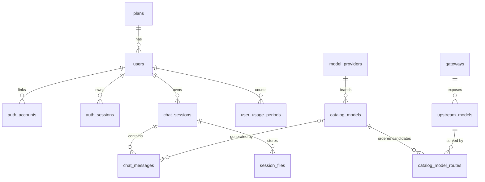

# 01 — Database Schema (Draft)

> Status: **DRAFT — menunggu review**. Belum ada migration yang dijalankan.
> Engine: **MariaDB 10.11** (VPS `194.233.78.169:3306`), InnoDB, `utf8mb4`.
> ORM / migration: **Prisma** (provider `mysql` + driver adapter MariaDB) — detail setup di Phase 1.

## 1. Prinsip

1. **Semua routing & katalog model dikelola dari DB lewat admin panel.** Tidak ada gateway, model, urutan fallback, atau aturan retry yang di-hardcode di kode / `.env` (lihat `ARCHITECTURE_RULES.md` §9).
2. **Index diturunkan dari query nyata** (tabel §5). Setiap FK punya index, tidak ada index duplikat dari PK/UNIQUE.
3. **Aturan data = constraint DB**: `NOT NULL`, `UNIQUE`, `CHECK`, FK dengan `ON DELETE` yang disengaja.
4. **Konvensi kolom**
   - PK: `BIGINT UNSIGNED AUTO_INCREMENT` (InnoDB cluster by PK → insert berurutan, index kecil).
   - ID yang terlihat user (URL `/c/[uuid]`, API): `public_id CHAR(36)` **UUIDv7** (format standar `8-4-4-4-12`, time-ordered → insert index tetap berurutan), `ascii_bin`, dibuat oleh app (`@default(uuid(7))` di Prisma). ID internal **tidak pernah** keluar ke client. Route Handler wajib validasi format UUID sebelum query.
   - Waktu: `DATETIME(3)` dalam **UTC** (diset app / `CURRENT_TIMESTAMP(3)` dengan koneksi `time_zone='+00:00'`).
   - `updated_at`: `ON UPDATE CURRENT_TIMESTAMP(3)` (+ `@updatedAt` di Prisma).
   - Collation default `utf8mb4_uca1400_ai_ci` (case-insensitive → email unik tanpa beda huruf besar/kecil). Identifier teknis (slug, model id upstream, storage key) pakai `ascii_bin` / `utf8mb4_bin` supaya case-sensitive & hemat byte.
   - Panjang `VARCHAR` dipilih sesuai data (MariaDB wajib panjang), bukan `255` kebiasaan.
   - Enum-like value: `VARCHAR` + `CHECK` (mudah di-evolve dibanding `ENUM`).
   - Secret (API key gateway) disimpan **terenkripsi AES-256-GCM** (`VARBINARY`). Kunci enkripsi = satu-satunya secret routing di env: `GATEWAY_SECRET_KEY`.

## 2. Entity & relasi

| Entity | Relasi |
|---|---|
| `plans` | 1:N `users` |
| `users` | 1:N `auth_accounts`, `auth_sessions`, `chat_sessions`, `session_files` |
| `gateways` | 1:N `upstream_models` |
| `upstream_models` | hasil sync `GET {base_url}{models_path}` per gateway; 1:N `catalog_model_routes` |
| `model_providers` | brand + logo (OpenAI, Anthropic, Google, …); 1:N `catalog_models` |
| `catalog_models` | model yang tampil di chat (`openai/gpt-6-luna`); 1:N `catalog_model_routes` |
| `catalog_model_routes` | **kandidat routing berurutan** = N:M `catalog_models` ↔ `upstream_models` + `priority` |
| `app_settings` | key-value JSON: semua parameter routing/fallback/cache |
| `chat_sessions` | 1:N `chat_messages`, `session_files` |
| `routing_attempts` | log setiap percobaan ke gateway (append-only) |
| `user_usage_periods` | counter kuota per user per periode |
| `admin_audit_logs` | jejak perubahan admin (gateway, katalog, setting) |



Contoh data untuk kasus `openai/gpt-6-luna`:

| catalog_model | priority | gateway (`is_primary`) | upstream `model_key` |
|---|---|---|---|
| `openai/gpt-6-luna` | 1 | Gateway A (✅ primary) | `gpt-6-luna` |
| `openai/gpt-6-luna` | 2 | Gateway B | `gpt-5.6-luna` |
| `openai/gpt-6-luna` | 3 | Gateway C | `gpt-5.6-luna` |

Gateway A error → otomatis lanjut ke Gateway B dengan model upstream **berbeda** (`gpt-5.6-luna`). Detail algoritma di `03-smart-routing.md`.

## 3. DDL (MariaDB 10.11)

```sql
SET time_zone = '+00:00';
-- Database default: CHARACTER SET utf8mb4 COLLATE utf8mb4_uca1400_ai_ci

-- ───────────── Users & auth ─────────────
CREATE TABLE plans (
  id                   BIGINT UNSIGNED NOT NULL AUTO_INCREMENT,
  slug                 VARCHAR(32) CHARACTER SET ascii COLLATE ascii_bin NOT NULL,
  name                 VARCHAR(80)  NOT NULL,
  monthly_token_limit  BIGINT UNSIGNED NULL,          -- NULL = unlimited
  daily_request_limit  INT UNSIGNED NULL,
  requests_per_minute  SMALLINT UNSIGNED NULL,
  created_at           DATETIME(3) NOT NULL DEFAULT CURRENT_TIMESTAMP(3),
  updated_at           DATETIME(3) NOT NULL DEFAULT CURRENT_TIMESTAMP(3) ON UPDATE CURRENT_TIMESTAMP(3),
  PRIMARY KEY (id),
  UNIQUE KEY uq_plans_slug (slug)
) ENGINE=InnoDB;

CREATE TABLE users (
  id             BIGINT UNSIGNED NOT NULL AUTO_INCREMENT,
  public_id      CHAR(36) CHARACTER SET ascii COLLATE ascii_bin NOT NULL,
  email          VARCHAR(320) NOT NULL,                -- collation _ai_ci → unik case-insensitive
  name           VARCHAR(120) NOT NULL,
  avatar_url     VARCHAR(2048) NULL,
  role           VARCHAR(16) NOT NULL DEFAULT 'user',
  status         VARCHAR(16) NOT NULL DEFAULT 'active',
  plan_id        BIGINT UNSIGNED NULL,
  last_login_at  DATETIME(3) NULL,
  created_at     DATETIME(3) NOT NULL DEFAULT CURRENT_TIMESTAMP(3),
  updated_at     DATETIME(3) NOT NULL DEFAULT CURRENT_TIMESTAMP(3) ON UPDATE CURRENT_TIMESTAMP(3),
  PRIMARY KEY (id),
  UNIQUE KEY uq_users_public_id (public_id),
  UNIQUE KEY uq_users_email (email),
  KEY idx_users_plan (plan_id),
  KEY idx_users_role_status (role, status),
  CONSTRAINT fk_users_plan FOREIGN KEY (plan_id) REFERENCES plans (id) ON DELETE SET NULL,
  CONSTRAINT chk_users_role   CHECK (role IN ('user', 'admin')),
  CONSTRAINT chk_users_status CHECK (status IN ('active', 'suspended'))
) ENGINE=InnoDB;

CREATE TABLE auth_accounts (                          -- Login with Google (OAuth)
  id                   BIGINT UNSIGNED NOT NULL AUTO_INCREMENT,
  user_id              BIGINT UNSIGNED NOT NULL,
  provider             VARCHAR(32) CHARACTER SET ascii COLLATE ascii_bin NOT NULL,
  provider_account_id  VARCHAR(191) CHARACTER SET ascii COLLATE ascii_bin NOT NULL,
  created_at           DATETIME(3) NOT NULL DEFAULT CURRENT_TIMESTAMP(3),
  PRIMARY KEY (id),
  UNIQUE KEY uq_auth_accounts_provider (provider, provider_account_id),
  KEY idx_auth_accounts_user (user_id),
  CONSTRAINT fk_auth_accounts_user FOREIGN KEY (user_id) REFERENCES users (id) ON DELETE CASCADE
) ENGINE=InnoDB;

CREATE TABLE auth_sessions (
  id          BIGINT UNSIGNED NOT NULL AUTO_INCREMENT,
  user_id     BIGINT UNSIGNED NOT NULL,
  token_hash  BINARY(32) NOT NULL,                     -- SHA-256 dari cookie token, token mentah tidak disimpan
  expires_at  DATETIME(3) NOT NULL,
  ip_address  VARCHAR(45) NULL,
  user_agent  VARCHAR(512) NULL,
  created_at  DATETIME(3) NOT NULL DEFAULT CURRENT_TIMESTAMP(3),
  PRIMARY KEY (id),
  UNIQUE KEY uq_auth_sessions_token (token_hash),
  KEY idx_auth_sessions_user (user_id),
  KEY idx_auth_sessions_expires (expires_at),          -- job cleanup sesi kedaluwarsa
  CONSTRAINT fk_auth_sessions_user FOREIGN KEY (user_id) REFERENCES users (id) ON DELETE CASCADE
) ENGINE=InnoDB;

-- ───────────── Gateways & upstream catalog ─────────────
CREATE TABLE gateways (
  id                      BIGINT UNSIGNED NOT NULL AUTO_INCREMENT,
  slug                    VARCHAR(64) CHARACTER SET ascii COLLATE ascii_bin NOT NULL,
  name                    VARCHAR(120) NOT NULL,
  base_url                VARCHAR(2048) NOT NULL,      -- contoh: https://gw-a.example.com/v1
  wire_api                VARCHAR(16) NOT NULL DEFAULT 'chat',   -- chat → /chat/completions, responses → /responses
  models_path             VARCHAR(255) NOT NULL DEFAULT '/models',
  api_key_ciphertext      VARBINARY(1024) NOT NULL,    -- AES-256-GCM (iv|tag|ciphertext)
  api_key_last4           CHAR(4) NULL,                -- hanya untuk tampilan admin
  extra_headers           JSON NULL,                   -- header non-secret opsional
  is_primary              TINYINT(1) NOT NULL DEFAULT 0,
  primary_marker          TINYINT AS (IF(is_primary = 1, 1, NULL)) PERSISTENT,
  is_enabled              TINYINT(1) NOT NULL DEFAULT 1,
  priority                SMALLINT UNSIGNED NOT NULL DEFAULT 100,  -- urutan antar gateway non-primary
  timeout_ms              INT UNSIGNED NOT NULL DEFAULT 120000,
  first_token_timeout_ms  INT UNSIGNED NOT NULL DEFAULT 20000,
  -- health / circuit breaker (diupdate router)
  health_status           VARCHAR(16) NOT NULL DEFAULT 'unknown',
  consecutive_failures    SMALLINT UNSIGNED NOT NULL DEFAULT 0,
  circuit_open_until      DATETIME(3) NULL,
  last_success_at         DATETIME(3) NULL,
  last_failure_at         DATETIME(3) NULL,
  last_synced_at          DATETIME(3) NULL,
  created_at              DATETIME(3) NOT NULL DEFAULT CURRENT_TIMESTAMP(3),
  updated_at              DATETIME(3) NOT NULL DEFAULT CURRENT_TIMESTAMP(3) ON UPDATE CURRENT_TIMESTAMP(3),
  PRIMARY KEY (id),
  UNIQUE KEY uq_gateways_slug (slug),
  UNIQUE KEY uq_gateways_single_primary (primary_marker),  -- NULL boleh banyak, nilai 1 hanya satu → maks 1 primary
  KEY idx_gateways_routing (is_enabled, is_primary, priority),
  CONSTRAINT chk_gateways_wire_api CHECK (wire_api IN ('chat', 'responses')),
  CONSTRAINT chk_gateways_health   CHECK (health_status IN ('unknown', 'healthy', 'degraded', 'down')),
  CONSTRAINT chk_gateways_primary_enabled CHECK (NOT (is_primary = 1 AND is_enabled = 0))
) ENGINE=InnoDB;

CREATE TABLE upstream_models (
  id             BIGINT UNSIGNED NOT NULL AUTO_INCREMENT,
  gateway_id     BIGINT UNSIGNED NOT NULL,
  model_key      VARCHAR(191) CHARACTER SET utf8mb4 COLLATE utf8mb4_bin NOT NULL,  -- "id" dari /v1/models
  owned_by       VARCHAR(120) NULL,
  is_available   TINYINT(1) NOT NULL DEFAULT 1,        -- 0 jika hilang di sync terakhir (row TIDAK dihapus)
  raw_metadata   JSON NULL,
  first_seen_at  DATETIME(3) NOT NULL,
  last_seen_at   DATETIME(3) NOT NULL,
  created_at     DATETIME(3) NOT NULL DEFAULT CURRENT_TIMESTAMP(3),
  updated_at     DATETIME(3) NOT NULL DEFAULT CURRENT_TIMESTAMP(3) ON UPDATE CURRENT_TIMESTAMP(3),
  PRIMARY KEY (id),
  UNIQUE KEY uq_upstream_models_gateway_key (gateway_id, model_key),
  KEY idx_upstream_models_gateway_avail (gateway_id, is_available, model_key),
  KEY idx_upstream_models_key (model_key),             -- admin: "gateway mana saja yang punya gpt-5.6-luna?"
  CONSTRAINT fk_upstream_models_gateway FOREIGN KEY (gateway_id) REFERENCES gateways (id) ON DELETE CASCADE
) ENGINE=InnoDB;

-- ───────────── Public catalog (yang dilihat user) ─────────────
CREATE TABLE model_providers (
  id          BIGINT UNSIGNED NOT NULL AUTO_INCREMENT,
  slug        VARCHAR(32) CHARACTER SET ascii COLLATE ascii_bin NOT NULL,   -- openai, anthropic, google, deepseek…
  name        VARCHAR(80) NOT NULL,
  logo_key    VARCHAR(64) CHARACTER SET ascii COLLATE ascii_bin NOT NULL,  -- /public/brand-logos/{logo_key}.svg
  logo_url    VARCHAR(2048) NULL,                       -- override upload custom (R2)
  sort_order  SMALLINT UNSIGNED NOT NULL DEFAULT 100,
  created_at  DATETIME(3) NOT NULL DEFAULT CURRENT_TIMESTAMP(3),
  updated_at  DATETIME(3) NOT NULL DEFAULT CURRENT_TIMESTAMP(3) ON UPDATE CURRENT_TIMESTAMP(3),
  PRIMARY KEY (id),
  UNIQUE KEY uq_model_providers_slug (slug)
) ENGINE=InnoDB;

CREATE TABLE catalog_models (
  id                  BIGINT UNSIGNED NOT NULL AUTO_INCREMENT,
  public_id           VARCHAR(128) CHARACTER SET ascii COLLATE ascii_general_ci NOT NULL,  -- openai/gpt-6-luna
  display_name        VARCHAR(120) NOT NULL,
  short_name          VARCHAR(60)  NOT NULL,
  description         VARCHAR(500) NULL,
  provider_id         BIGINT UNSIGNED NOT NULL,
  category            VARCHAR(16) NOT NULL DEFAULT 'powerful',
  badge               VARCHAR(32) NULL,
  context_window      INT UNSIGNED NULL,
  max_output_tokens   INT UNSIGNED NULL,
  supports_vision     TINYINT(1) NOT NULL DEFAULT 0,
  supports_tools      TINYINT(1) NOT NULL DEFAULT 0,
  supports_reasoning  TINYINT(1) NOT NULL DEFAULT 0,
  status              VARCHAR(16) NOT NULL DEFAULT 'draft',
  sort_order          SMALLINT UNSIGNED NOT NULL DEFAULT 100,
  created_at          DATETIME(3) NOT NULL DEFAULT CURRENT_TIMESTAMP(3),
  updated_at          DATETIME(3) NOT NULL DEFAULT CURRENT_TIMESTAMP(3) ON UPDATE CURRENT_TIMESTAMP(3),
  PRIMARY KEY (id),
  UNIQUE KEY uq_catalog_models_public_id (public_id),
  KEY idx_catalog_models_listing (status, sort_order),  -- GET /api/v1/models
  KEY idx_catalog_models_provider (provider_id),
  CONSTRAINT fk_catalog_models_provider FOREIGN KEY (provider_id) REFERENCES model_providers (id) ON DELETE RESTRICT,
  CONSTRAINT chk_catalog_models_public_id CHECK (public_id REGEXP '^[a-z0-9][a-z0-9._-]*/[a-z0-9][a-z0-9._-]*$'),
  CONSTRAINT chk_catalog_models_category  CHECK (category IN ('powerful', 'fast')),
  CONSTRAINT chk_catalog_models_status    CHECK (status IN ('draft', 'active', 'hidden', 'disabled'))
) ENGINE=InnoDB;

CREATE TABLE catalog_model_routes (                   -- kandidat smart routing
  id                 BIGINT UNSIGNED NOT NULL AUTO_INCREMENT,
  catalog_model_id   BIGINT UNSIGNED NOT NULL,
  upstream_model_id  BIGINT UNSIGNED NOT NULL,
  priority           SMALLINT UNSIGNED NOT NULL,       -- 1 = dicoba pertama (setelah aturan primary-first)
  is_enabled         TINYINT(1) NOT NULL DEFAULT 1,
  param_overrides    JSON NULL,                        -- mis. mapping reasoning_effort / cap max_tokens per kandidat
  created_at         DATETIME(3) NOT NULL DEFAULT CURRENT_TIMESTAMP(3),
  updated_at         DATETIME(3) NOT NULL DEFAULT CURRENT_TIMESTAMP(3) ON UPDATE CURRENT_TIMESTAMP(3),
  PRIMARY KEY (id),
  UNIQUE KEY uq_routes_model_upstream (catalog_model_id, upstream_model_id),
  KEY idx_routes_resolve (catalog_model_id, is_enabled, priority),
  KEY idx_routes_upstream (upstream_model_id),         -- reverse lookup + FK
  CONSTRAINT fk_routes_catalog_model  FOREIGN KEY (catalog_model_id)  REFERENCES catalog_models (id)  ON DELETE CASCADE,
  CONSTRAINT fk_routes_upstream_model FOREIGN KEY (upstream_model_id) REFERENCES upstream_models (id) ON DELETE CASCADE
) ENGINE=InnoDB;

CREATE TABLE app_settings (
  setting_key  VARCHAR(64) CHARACTER SET ascii COLLATE ascii_bin NOT NULL,
  value        JSON NOT NULL,
  updated_by   BIGINT UNSIGNED NULL,
  updated_at   DATETIME(3) NOT NULL DEFAULT CURRENT_TIMESTAMP(3) ON UPDATE CURRENT_TIMESTAMP(3),
  PRIMARY KEY (setting_key),
  KEY idx_app_settings_updated_by (updated_by),
  CONSTRAINT fk_app_settings_user FOREIGN KEY (updated_by) REFERENCES users (id) ON DELETE SET NULL
) ENGINE=InnoDB;

-- ───────────── Chat ─────────────
CREATE TABLE chat_sessions (
  id                BIGINT UNSIGNED NOT NULL AUTO_INCREMENT,
  public_id         CHAR(36) CHARACTER SET ascii COLLATE ascii_bin NOT NULL,   -- /c/{public_id}
  user_id           BIGINT UNSIGNED NOT NULL,
  title             VARCHAR(200) NOT NULL DEFAULT 'New chat',
  catalog_model_id  BIGINT UNSIGNED NULL,               -- model terakhir dipilih
  is_pinned         TINYINT(1) NOT NULL DEFAULT 0,
  last_message_at   DATETIME(3) NOT NULL DEFAULT CURRENT_TIMESTAMP(3),
  created_at        DATETIME(3) NOT NULL DEFAULT CURRENT_TIMESTAMP(3),
  updated_at        DATETIME(3) NOT NULL DEFAULT CURRENT_TIMESTAMP(3) ON UPDATE CURRENT_TIMESTAMP(3),
  PRIMARY KEY (id),
  UNIQUE KEY uq_chat_sessions_public_id (public_id),
  KEY idx_chat_sessions_sidebar (user_id, is_pinned DESC, last_message_at DESC, id DESC),
  KEY idx_chat_sessions_model (catalog_model_id),
  CONSTRAINT fk_chat_sessions_user  FOREIGN KEY (user_id)          REFERENCES users (id)          ON DELETE CASCADE,
  CONSTRAINT fk_chat_sessions_model FOREIGN KEY (catalog_model_id) REFERENCES catalog_models (id) ON DELETE SET NULL
) ENGINE=InnoDB;

CREATE TABLE chat_messages (
  id                 BIGINT UNSIGNED NOT NULL AUTO_INCREMENT,
  public_id          CHAR(36) CHARACTER SET ascii COLLATE ascii_bin NOT NULL,
  session_id         BIGINT UNSIGNED NOT NULL,
  role               VARCHAR(16) NOT NULL,
  content            MEDIUMTEXT NOT NULL,
  reasoning          MEDIUMTEXT NULL,
  parts              JSON NULL,                         -- tool calls / tool results / attachment refs
  catalog_model_id   BIGINT UNSIGNED NULL,              -- model publik (BUKAN gateway/upstream)
  status             VARCHAR(16) NOT NULL DEFAULT 'completed',
  error_code         VARCHAR(64) NULL,
  prompt_tokens      INT UNSIGNED NULL,
  completion_tokens  INT UNSIGNED NULL,
  created_at         DATETIME(3) NOT NULL DEFAULT CURRENT_TIMESTAMP(3),
  updated_at         DATETIME(3) NOT NULL DEFAULT CURRENT_TIMESTAMP(3) ON UPDATE CURRENT_TIMESTAMP(3),
  PRIMARY KEY (id),
  UNIQUE KEY uq_chat_messages_public_id (public_id),
  KEY idx_chat_messages_session (session_id, id),       -- load history berurutan + cursor pagination
  KEY idx_chat_messages_status (status, updated_at),    -- job: tandai 'streaming' yang macet setelah crash
  KEY idx_chat_messages_model (catalog_model_id),
  CONSTRAINT fk_chat_messages_session FOREIGN KEY (session_id)       REFERENCES chat_sessions (id)  ON DELETE CASCADE,
  CONSTRAINT fk_chat_messages_model   FOREIGN KEY (catalog_model_id) REFERENCES catalog_models (id) ON DELETE SET NULL,
  CONSTRAINT chk_chat_messages_role   CHECK (role IN ('user', 'assistant', 'system', 'tool')),
  CONSTRAINT chk_chat_messages_status CHECK (status IN ('pending', 'streaming', 'completed', 'error', 'aborted'))
) ENGINE=InnoDB;

CREATE TABLE session_files (                          -- metadata file di R2 (upload user & hasil write_file)
  id           BIGINT UNSIGNED NOT NULL AUTO_INCREMENT,
  public_id    CHAR(36) CHARACTER SET ascii COLLATE ascii_bin NOT NULL,
  user_id      BIGINT UNSIGNED NOT NULL,
  session_id   BIGINT UNSIGNED NOT NULL,
  message_id   BIGINT UNSIGNED NULL,
  filename     VARCHAR(128) CHARACTER SET utf8mb4 COLLATE utf8mb4_bin NOT NULL,  -- = sanitizeKey()
  storage_key  VARCHAR(512) CHARACTER SET ascii COLLATE ascii_bin NOT NULL,
  mime_type    VARCHAR(127) NOT NULL,
  size_bytes   BIGINT UNSIGNED NOT NULL,
  source       VARCHAR(16) NOT NULL,
  created_at   DATETIME(3) NOT NULL DEFAULT CURRENT_TIMESTAMP(3),
  PRIMARY KEY (id),
  UNIQUE KEY uq_session_files_public_id (public_id),
  UNIQUE KEY uq_session_files_name (session_id, filename),   -- tools mengakses file by filename
  UNIQUE KEY uq_session_files_storage_key (storage_key),
  KEY idx_session_files_user (user_id, created_at),
  KEY idx_session_files_message (message_id),
  CONSTRAINT fk_session_files_user    FOREIGN KEY (user_id)    REFERENCES users (id)         ON DELETE CASCADE,
  CONSTRAINT fk_session_files_session FOREIGN KEY (session_id) REFERENCES chat_sessions (id) ON DELETE CASCADE,
  CONSTRAINT fk_session_files_message FOREIGN KEY (message_id) REFERENCES chat_messages (id) ON DELETE SET NULL,
  CONSTRAINT chk_session_files_source CHECK (source IN ('upload', 'tool'))
) ENGINE=InnoDB;

-- ───────────── Observability & quota ─────────────
CREATE TABLE routing_attempts (                       -- append-only, sengaja TANPA FK (log tetap ada walau data dihapus, insert cepat)
  id                 BIGINT UNSIGNED NOT NULL AUTO_INCREMENT,
  request_id         CHAR(36) CHARACTER SET ascii COLLATE ascii_bin NOT NULL,
  user_id            BIGINT UNSIGNED NULL,
  message_id         BIGINT UNSIGNED NULL,
  catalog_model_id   BIGINT UNSIGNED NOT NULL,
  gateway_id         BIGINT UNSIGNED NOT NULL,
  upstream_model_id  BIGINT UNSIGNED NOT NULL,
  attempt_no         TINYINT UNSIGNED NOT NULL,
  outcome            VARCHAR(16) NOT NULL,
  error_class        VARCHAR(32) NULL,
  http_status        SMALLINT UNSIGNED NULL,
  latency_ms         INT UNSIGNED NOT NULL,
  ttft_ms            INT UNSIGNED NULL,
  prompt_tokens      INT UNSIGNED NULL,
  completion_tokens  INT UNSIGNED NULL,
  created_at         DATETIME(3) NOT NULL DEFAULT CURRENT_TIMESTAMP(3),
  PRIMARY KEY (id),
  KEY idx_attempts_created (created_at),               -- retention purge + dashboard rentang waktu
  KEY idx_attempts_gateway (gateway_id, created_at),   -- error rate per gateway
  KEY idx_attempts_model (catalog_model_id, created_at),
  KEY idx_attempts_user (user_id, created_at),
  KEY idx_attempts_request (request_id),
  CONSTRAINT chk_attempts_outcome CHECK (outcome IN ('success', 'fallback', 'failed', 'aborted'))
) ENGINE=InnoDB;

CREATE TABLE user_usage_periods (                     -- upsert: INSERT … ON DUPLICATE KEY UPDATE
  user_id            BIGINT UNSIGNED NOT NULL,
  period_start       DATE NOT NULL,
  request_count      INT UNSIGNED NOT NULL DEFAULT 0,
  prompt_tokens      BIGINT UNSIGNED NOT NULL DEFAULT 0,
  completion_tokens  BIGINT UNSIGNED NOT NULL DEFAULT 0,
  updated_at         DATETIME(3) NOT NULL DEFAULT CURRENT_TIMESTAMP(3) ON UPDATE CURRENT_TIMESTAMP(3),
  PRIMARY KEY (user_id, period_start),
  CONSTRAINT fk_usage_user FOREIGN KEY (user_id) REFERENCES users (id) ON DELETE CASCADE
) ENGINE=InnoDB;

CREATE TABLE admin_audit_logs (
  id             BIGINT UNSIGNED NOT NULL AUTO_INCREMENT,
  actor_user_id  BIGINT UNSIGNED NULL,
  action         VARCHAR(64) NOT NULL,                  -- gateway.update, catalog.routes.replace, settings.update…
  entity_type    VARCHAR(32) NOT NULL,
  entity_id      VARCHAR(128) NULL,
  before_state   JSON NULL,                             -- secret SELALU di-redact
  after_state    JSON NULL,
  created_at     DATETIME(3) NOT NULL DEFAULT CURRENT_TIMESTAMP(3),
  PRIMARY KEY (id),
  KEY idx_audit_entity (entity_type, entity_id, created_at),
  KEY idx_audit_actor (actor_user_id, created_at),
  KEY idx_audit_created (created_at),
  CONSTRAINT fk_audit_actor FOREIGN KEY (actor_user_id) REFERENCES users (id) ON DELETE SET NULL
) ENGINE=InnoDB;
```

## 4. Seed wajib (`app_settings`) — bukan hardcode di kode router

| key | default seed | fungsi |
|---|---|---|
| `routing.primary_first` | `true` | kandidat di gateway primary selalu dicoba duluan |
| `routing.max_attempts` | `3` | maksimal percobaan per request |
| `routing.retry_on_status` | `[408, 409, 425, 429, 500, 502, 503, 504]` | HTTP status yang memicu fallback |
| `routing.fallback_on_model_not_found` | `true` | 404 / `model_not_found` → fallback |
| `routing.circuit_failure_threshold` | `5` | gagal berturut-turut → circuit open |
| `routing.circuit_cooldown_seconds` | `60` | lama circuit open |
| `routing.cache_ttl_seconds` | `30` | TTL cache tabel routing di memori |
| `routing.version` | `1` | dinaikkan setiap admin mengubah gateway/katalog → invalidasi cache |
| `catalog.default_model` | `"openai/gpt-6-luna"` | model default di composer |
| `logs.routing_retention_days` | `90` | purge `routing_attempts` |

Router **menolak start** (health check gagal + banner di admin) jika key wajib tidak ada — tidak ada nilai cadangan di kode.

## 5. Query utama → index yang melayani

| # | Query | Index |
|---|---|---|
| Q1 | Resolve kandidat routing untuk `public_id` (hot path, di-cache) | `uq_catalog_models_public_id` → `idx_routes_resolve` → PK `upstream_models` → PK `gateways` |
| Q2 | List model untuk composer: `status='active' ORDER BY sort_order` | `idx_catalog_models_listing` |
| Q3 | Sidebar: sesi user, pinned dulu, terbaru dulu | `idx_chat_sessions_sidebar` (descending index, MariaDB ≥10.8) |
| Q4 | Buka `/c/{public_id}` | `uq_chat_sessions_public_id` |
| Q5 | History pesan sesi (cursor `id < ?` / `id > ?`) | `idx_chat_messages_session` |
| Q6 | Sync `/v1/models`: upsert per `(gateway_id, model_key)` + tandai yang hilang | `uq_upstream_models_gateway_key`, `idx_upstream_models_gateway_avail` |
| Q7 | Admin: daftar model upstream per gateway (filter available, urut nama) | `idx_upstream_models_gateway_avail` |
| Q8 | Admin: cari model_key di semua gateway (picker kandidat) | `idx_upstream_models_key` |
| Q9 | Cek kuota user periode ini | PK `user_usage_periods` |
| Q10 | Dashboard error rate per gateway 24 jam | `idx_attempts_gateway` |
| Q11 | Tools `read_file`/`vision_tool`: file by `(session, filename)` | `uq_session_files_name` |
| Q12 | Validasi cookie sesi login | `uq_auth_sessions_token` |
| Q13 | Purge log lama / sesi login kedaluwarsa | `idx_attempts_created`, `idx_auth_sessions_expires` |

## 6. Catatan & keputusan terbuka

- **Maks 1 gateway primary** dijamin DB via kolom generated `primary_marker` + UNIQUE (NULL boleh berulang). Perpindahan primary dilakukan dalam satu transaksi (`is_primary=0` di yang lama → `1` di yang baru). **Verifikasi Phase 1:** Prisma belum memodelkan generated column secara native → kolom ditulis via raw SQL migration (`prisma migrate dev --create-only`) dan dicek tidak memicu drift. Jika bermasalah, fallback: pointer `app_settings['routing.primary_gateway_id']`.
- **Hapus gateway** → cascade ke `upstream_models` → cascade ke `catalog_model_routes`. Admin UI wajib menampilkan konfirmasi berisi daftar route yang ikut terhapus; rekomendasi default = *disable*, bukan delete.
- **Sync model tidak pernah menghapus row** — hanya `is_available=0`, supaya route admin tidak hilang saat gateway sementara tidak melaporkan model.
- **Hapus chat session** → cascade messages & `session_files` di DB, tetapi objek R2 harus dihapus oleh service (prefix `users/{u}/sessions/{s}/`).
- `routing_attempts` volume tinggi → retention via job; jika > ±50 juta row, pertimbangkan `PARTITION BY RANGE` per bulan.
- Struktur final tabel `auth_*` mengikuti library auth yang dipilih di Phase 2 (tabel di atas adalah model logikanya).
- Gateway/upstream **tidak pernah** disimpan di `chat_messages` atau dikirim ke client; hanya ada di `routing_attempts` (admin-only).
